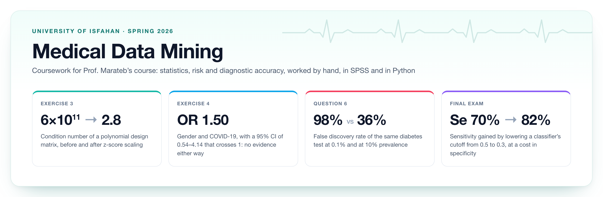
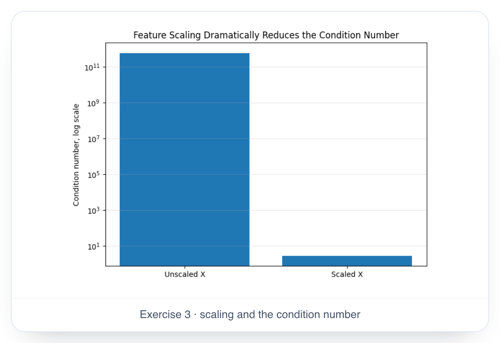
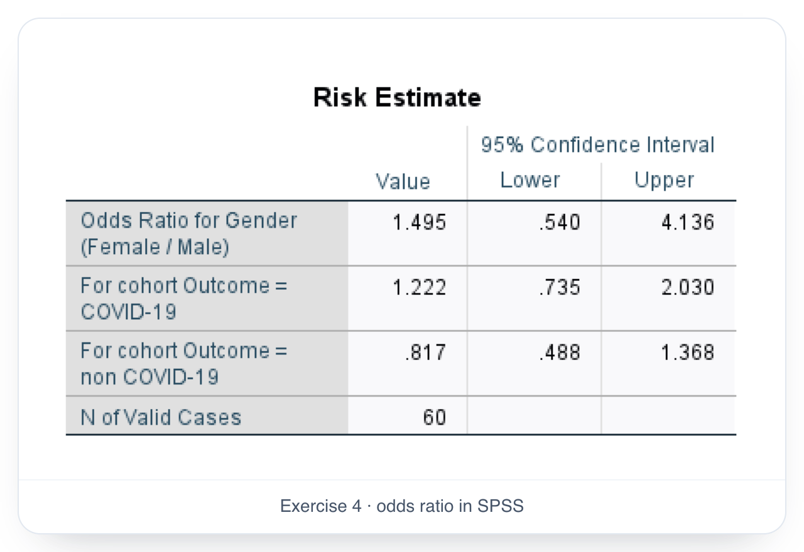
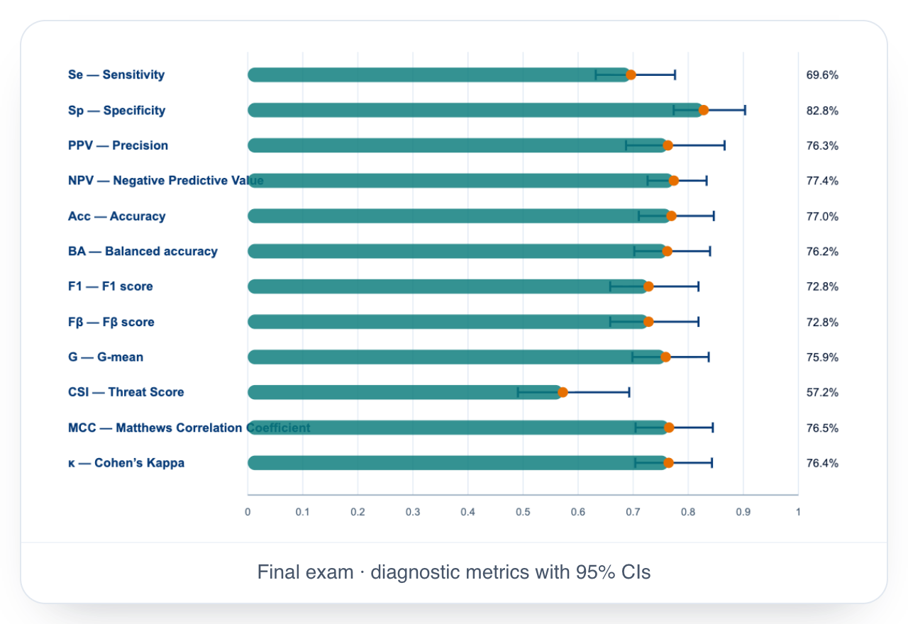

<div align="center">



</div>

<br>

Exercises, short written questions and the final exam from Prof. Marateb's medical data mining course at the University of Isfahan, spring 2026. The work moves between hand calculation, SPSS and Python, and keeps coming back to one theme: what a number really says about patients, and when it doesn't.

## Exercises

Group work, with full write-ups.

| | Topic | |
| :-- | :-- | :-- |
| **03** | Outlier detection with 3σ, Hampel and Tukey, and how min-max and z-score scaling tame an ill-conditioned least-squares problem | [notebooks](exercises/03-outliers-and-scaling) · [PDF](exercises/03-outliers-and-scaling/scaling-comparison.pdf) |
| **04** | Gender and COVID-19: a crosstab and odds ratio in SPSS, checked by hand | [PDF](exercises/04-odds-ratio/odds-ratio.pdf) · [source](exercises/04-odds-ratio) |
| **06** | The odds ratio again, plus the false-positive rate of a diabetes test through Bayes' rule | [PDF](exercises/06-odds-ratio-and-false-positives/odds-ratio-and-false-positives.pdf) · [source](exercises/06-odds-ratio-and-false-positives) |

## Questions

Group work too, in shorter pieces: a question, then our answer.

| | Topic | |
| :-- | :-- | :-- |
| **04** | Is neutrophil count correlated with LDH in patients without COVID-19? Choosing the test, Shapiro–Wilk, then Spearman | [PDF](questions/04-correlation-neutrophils-ldh.pdf) |
| **05** | How collinearity and the base rate move the pseudo-R² of a logistic regression, after Smith and McKenna | [PDF](questions/05-pseudo-r2-and-collinearity.pdf) |
| **06** | The false discovery rate of a diabetes test at the prevalence reported for children in Isfahan, and at 10% | [PDF](questions/06-false-discovery-rate/false-discovery-rate.pdf) · [source](questions/06-false-discovery-rate) |

## Final exam

Ten questions, answered individually: Bayes' rule for a screening test, skewness and Tukey's fences, normality and Spearman's rho in SPSS, an odds ratio with its confidence interval, the condition number of raw and standardized data, logistic regression in SPSS, cross-validated diagnostic metrics at two cutoffs, data leakage and nested cross-validation, and calibration versus discrimination when two models share an AUROC of 0.83.

[PDF](final-exam/final-exam.pdf) · [source](final-exam/final-exam.tex) · [notebooks](final-exam/notebooks)

<table>
<tr>
<td width="33%"></td>
<td width="33%"></td>
<td width="33%"></td>
</tr>
</table>

## About the data

The datasets behind this work are covered by a non-disclosure agreement, so none of them are here. The notebooks keep their code without its output, the outlier write-up gives counts instead of values, and the two screenshots in question 4 that showed patient records are blanked out. The scaling notebooks in exercise 3 build their own synthetic example, so they keep their plots.

## Building the reports

The reports are Persian LaTeX, built with XeLaTeX and [xepersian](https://ctan.org/pkg/xepersian). The fonts they use are in `fonts/`, so a TeX distribution is all you need:

```bash
latexmk final-exam/final-exam.tex
```

## About us

The exercises and questions were group work:

- Zahra Cheraghi &nbsp;[@elham-cheraghi](https://github.com/elham-cheraghi)
- Mohammad Mallaee &nbsp;[@mohammad-mallaee](https://github.com/mohammad-mallaee)
- Davoud Nosrati Amirabadi &nbsp;[@ausdavoud](https://github.com/ausdavoud)
